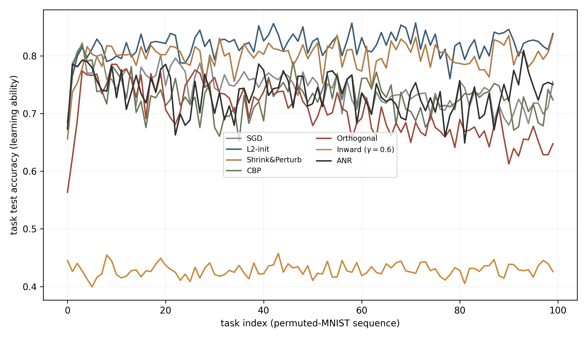
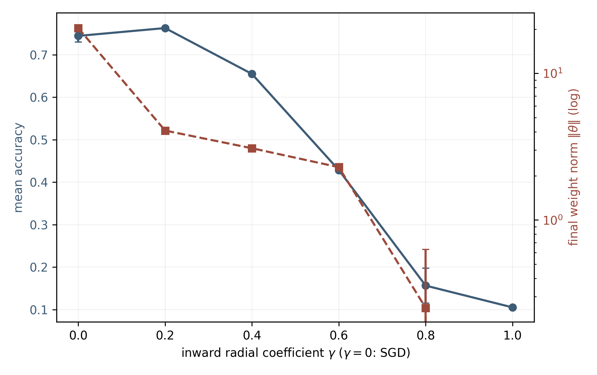
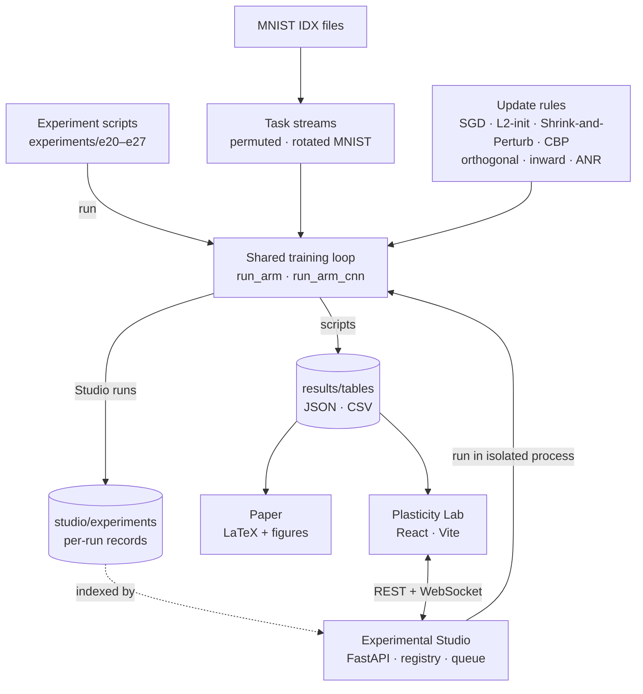
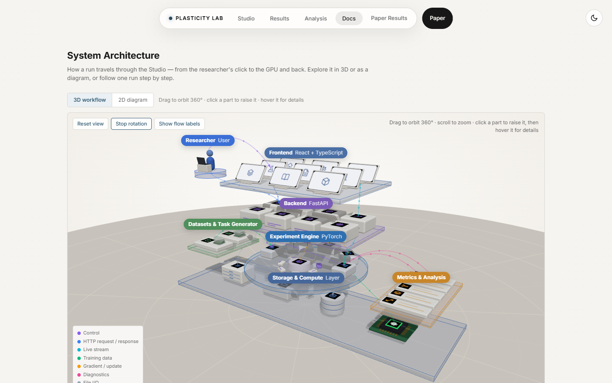
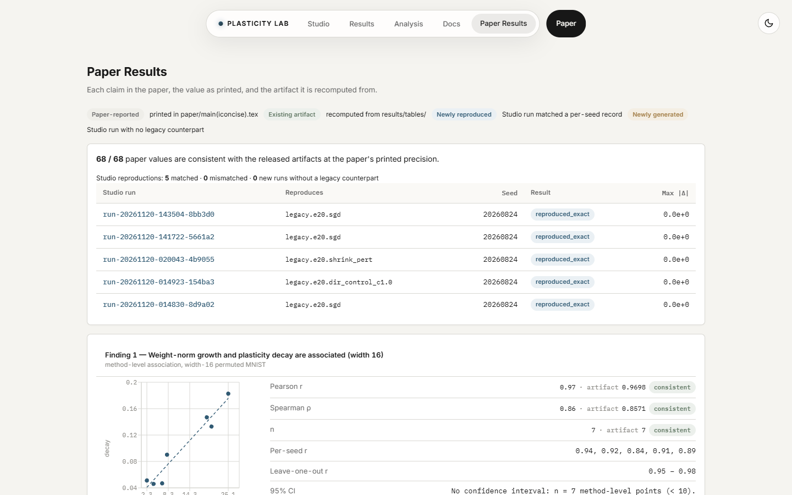

<div align="center">

# Weight-Norm Growth and Update Geometry in Loss of Plasticity

**A matched-step-size study of continual learning: research code, paper, and an interactive experiment lab**

[](https://lalith557.github.io/Directional-plasticity/)
[](LICENSE)
[](requirements.txt)
[](https://pytorch.org)
[](web)
[](studio)
[](Research%20Paper.pdf)

[**Live demo**](https://lalith557.github.io/Directional-plasticity/) •
[Overview](#overview) •
[Key results](#key-results) •
[Quick start](#quick-start) •
[Reproducing the paper](#reproducing-the-paper) •
[Plasticity Lab](#plasticity-lab-and-experimental-studio) •
[Citation](#citation)

</div>

---

## Overview

Networks trained on a long stream of tasks gradually lose **plasticity**: their ability to
learn *new* tasks declines even when those tasks are unrelated to earlier ones. The dominant
explanations are about update **magnitude** (weight-norm growth, drift from initialization,
dormant units), while subspace methods constrain update **direction**. A standard optimizer
changes both at once, so their effects are confounded.

This project isolates them with a **matched-step-size control**: every directional update rule
is rescaled to the exact length of the plain-SGD step at the same parameters, so methods differ
*only* in direction. The question it answers:

> **When the length of every update is held fixed, can changing its direction preserve plasticity?**

The repository contains everything needed to reproduce and inspect the answer:

| Component | Description |
|---|---|
| **Research code** | PyTorch implementation of the task streams, ten update rules and the shared training loop ([`src/`](src), [`experiments/`](experiments)) |
| **Results** | Every per-seed and aggregate result as JSON/CSV, plus the generated figures ([`results/`](results)) |
| **Paper** | *Weight-Norm Growth and Update Geometry in Loss of Plasticity: A Matched-Step-Size Study*, IEEE ICA 2026 ([PDF](Research%20Paper.pdf), [LaTeX](paper)) |
| **Plasticity Lab** | React application for exploring every result, with an interactive 3D/2D system architecture ([`web/`](web)) |
| **Experimental Studio** | FastAPI service that configures, queues, runs and validates real experiments from the browser ([`studio/`](studio)) |

---

## Key results

100-task permuted MNIST, 784-16-16-10 MLP, five seeds (mean ± std over seeds):

| Method | Family | Mean accuracy ↑ | Plasticity decay ↓ | Final ‖θ‖ | Dormant units | Step deviation |
|---|---|---:|---:|---:|---:|---:|
| **L2-init** (λ = 10⁻²) | magnitude | **0.819 ± 0.003** | 0.047 ± 0.012 | 6.6 | 11.3 % | — |
| Shrink & Perturb | magnitude | 0.799 ± 0.010 | **0.046 ± 0.016** | 4.2 | 0.6 % | — |
| SGD | baseline | 0.744 ± 0.015 | 0.133 ± 0.036 | 20.4 | 21.2 % | reference |
| ANR (proposed, per-unit) | per-unit magnitude | 0.735 ± 0.010 | 0.090 ± 0.027 | 7.9 | 0.6 % | — |
| Continual Backprop | unit resets | 0.728 ± 0.010 | 0.147 ± 0.019 | 19.1 | 22.5 % | — |
| Orthogonal steering | matched-step direction | 0.703 ± 0.007 | 0.183 ± 0.040 | 25.1 | 28.7 % | 2.2 × 10⁻⁷ |
| Inward steering (γ = 0.6) | matched-step direction | 0.429 ± 0.005 | 0.051 ± 0.006 | 2.3 | 7.5 % | 2.0 × 10⁻⁷ |

<table>
  <tr>
    <td width="55%"></td>
    <td width="45%"></td>
  </tr>
  <tr>
    <td><sub><b>Per-task accuracy over 100 tasks.</b> Magnitude methods stay trainable; SGD and orthogonal steering decline; inward steering never learns well.</sub></td>
    <td><sub><b>Radial-coefficient sweep.</b> Steering inward lowers the norm monotonically, but accuracy falls with it.</sub></td>
  </tr>
</table>

**Findings**

1. **Norm growth tracks plasticity loss under capacity stress.** Across the seven methods, final
   weight norm and decay correlate at Pearson r = +0.97 (method-level association), and raising
   the L2-init strength lowers both.
2. **Direction alone cannot shrink the norm for free.** Orthogonal steps raise the squared norm
   by exactly η² per step (confirmed on the real runs to a relative error of 3 × 10⁻⁸), and any
   norm reduction requires spending part of the step budget inward.
3. **Magnitude control beats matched-step direction control.** The best inward setting
   (γ = 0.2, accuracy 0.763) still trails L2-init and Shrink & Perturb; strong inward steering
   collapses learning.
4. **The norm–plasticity link is regime-dependent.** The association weakens at width 64
   (+0.45) and reverses where plasticity loss is mild (width 128: −0.52, rotated MNIST: −0.94,
   small CNN: −0.82). Weight-norm growth is a regime-specific correlate, not a universal cause.

All numbers are read directly from [`results/tables/`](results/tables); the full analysis is in
[EXPLANATION IN DEPTH.md](EXPLANATION%20IN%20DEPTH.md).

---

## Method

### Matched-step-size control

Every method runs through the same training loop (`run_arm` in
[`src/plasticity_stress.py`](src/plasticity_stress.py)); only the line that turns the SGD step
into the applied update differs. For the directional rules:

```python
delta = -lr * grad                # the plain-SGD step at the current parameters
eta = delta.norm()                # its length
d = rule(delta, theta)            # method-specific direction (orthogonal, inward, random, ...)
delta_applied = d * eta / d.norm()  # same length as SGD, different direction
theta = theta + delta_applied
```

The relative deviation between the applied and the SGD step length is logged at every step; its
maximum over all directional runs is 2.3 × 10⁻⁷ (floating-point precision).

### A fixed-step norm identity

For a step of length η along a unit direction d:

```math
\lVert \theta + \eta d \rVert^2 = \lVert \theta \rVert^2 + 2\eta\,\langle \theta, d \rangle + \eta^2
```

An orthogonal step (⟨θ, d⟩ = 0) must increase the squared norm by exactly η², and the norm can
only decrease when ⟨θ, d⟩ ≤ −η/2. This predicts both directional ablations before they are run.

---

## Architecture



Every number flows one way: from the shared training loop into versioned artifacts, and from
there into the paper and the web application. Neither the lab nor the Studio ever writes to
`results/tables/`.

---

## Quick start

### Prerequisites

| Requirement | Version | Notes |
|---|---|---|
| Python | 3.11 or newer | developed on 3.13 |
| PyTorch | 2.x | CUDA build recommended; CPU works for small runs |
| Node.js | 18 or newer | for the web application |
| GPU | optional | all paper experiments fit an 8 GB laptop GPU (RTX 4070) |

### Installation

```bash
git clone https://github.com/lalith557/Directional-plasticity.git
cd Directional-plasticity

# Python (install the CUDA build of PyTorch first if you have a GPU)
pip install torch --index-url https://download.pytorch.org/whl/cu128
pip install -r requirements.txt

# Web application
npm --prefix web install
```

### Data

Datasets are not tracked in git. Place the four standard MNIST IDX files (train and test images
and labels) in `Deep Learning Dataset1/`; both `train-images-idx3-ubyte` and
`train-images.idx3-ubyte` naming are accepted. Nothing is downloaded at run time.

| Folder | Contents | Required for |
|---|---|---|
| `Deep Learning Dataset1/` | MNIST IDX files | all paper experiments, the Studio, the tests |
| `cifar-10/`, `cifar100/` | Kaggle CIFAR-10 archive / CIFAR-100 PNGs | Phase-1 experiments only |

### Run

```bash
# One width-16, 100-task run per seed and method (~30 s each on an RTX 4070)
python experiments/e20_plasticity_stress.py

# Explore the results
npm --prefix web run dev            # http://localhost:5173
```

---

## Reproducing the paper

Each script writes its summary to `results/tables/` and its figures to `results/figures/`.

| Paper element | Command | Artifact |
|---|---|---|
| Table I, Fig. 2, norm–decay association | `python experiments/e20_plasticity_stress.py` | `e20_summary.json` |
| Width-64 regime, λ intervention sweep, ANR ablation | `python experiments/e22_reviewer_experiments.py` | `e22_arch64_summary.json`, `e22_lambda_summary.json`, `e22_anr_ablation_summary.json` |
| Width-128 and rotated-MNIST regimes | `python experiments/e24_generalization.py` | `e24_arch128_summary.json`, `e24_rotmnist_summary.json` |
| Small-CNN regime | `python experiments/e25_cnn.py` | `e25_cnn_summary.json` |
| Fig. 3, radial-coefficient sweep | `python experiments/e27_radial_sweep.py` | `e27_radial_sweep_summary.json` |
| Update-geometry controls (supplementary) | `python experiments/e23_update_geometry.py` | `e23_summary.json` |
| Layer-wise norms, alternative metrics (supplementary) | `python experiments/e26_diagnostics.py` | `e26_summary.json` |

To run the complete pipeline (Phase 1 and Phase 2 in dependency order, then rebuild the web
dataset):

```bash
python run_all.py                   # all stages
python run_all.py --only e20 e27    # selected stages
python run_all.py --skip e09_cifar100
```

The paper is built on Overleaf: upload `paper/main(iconcise).tex`, `paper/references.bib` and
`paper/figs/` as a new project and compile with pdfLaTeX.

Seeds are fixed (20260824–20260828), every stochastic component is seeded explicitly, and
MLP runs are bit-reproducible on the same hardware. The exact protocol (seeds, settings per
experiment, update-rule implementations, metric definitions) is documented in
[docs/STUDIO_GUIDE.md](docs/STUDIO_GUIDE.md#5-protocol-reference-exact-from-the-code).

---

## Plasticity Lab and Experimental Studio

<table>
  <tr>
    <td width="50%"></td>
    <td width="50%"></td>
  </tr>
  <tr>
    <td><sub><b>System architecture.</b> Interactive 3D and 2D views of how a run flows from the browser to the GPU, with a guided tour.</sub></td>
    <td><sub><b>Paper Results.</b> Every value printed in the paper, recomputed from its artifact and checked at the paper's precision.</sub></td>
  </tr>
</table>

> **Live demo:** a read-only build of Plasticity Lab is deployed to GitHub Pages at
> **https://lalith557.github.io/Directional-plasticity/** on every push to `main`
> ([workflow](.github/workflows/deploy-pages.yml)). The Studio features need the local backend
> and GPU, so they are available only when you run the project yourself.

**Plasticity Lab** ([`web/`](web)) is a Vite + React 18 + TypeScript application:

- **Results** — a page per experiment (main comparison, λ sweep, radial sweep, width study,
  rotated MNIST, CNN), a searchable results explorer, and paired-seed method comparison.
- **Analysis** — norm ↔ plasticity, update geometry with an interactive identity explorer,
  dormant units, effective rank, ablations and regime comparison.
- **Paper Results** — each paper claim mapped to the artifact it comes from.
- **Docs** — configuration, datasets, raw result files and the system architecture.

**Experimental Studio** ([`studio/`](studio)) turns the research code into a service:

- Configure any supported dataset, architecture and update rule; parameters are validated
  against what the training code actually implements.
- Runs execute one at a time on the GPU in isolated processes, each with an immutable,
  SHA-256-verified configuration snapshot and a recorded environment.
- Per-step progress and per-task metrics stream live to the browser over WebSockets.
- Runs that match a per-seed record from the paper are compared with it automatically; the
  SGD, Shrink & Perturb and orthogonal-steering records of Table I (seed 20260824) reproduce
  with every metric difference exactly 0.

```bash
python -m uvicorn studio.api.server:app --host 127.0.0.1 --port 8765   # backend
npm --prefix web run dev                                                # frontend (proxies /api)
```

The analysis pages work without the backend. API reference, run lifecycle and known
limitations: [docs/STUDIO_GUIDE.md](docs/STUDIO_GUIDE.md).

---

## Project structure

```
.
├── src/                          Research library
│   ├── plasticity_stress.py      Models, task streams, update rules, training loop (paper core)
│   ├── datasets.py, device.py    Data loaders; device selection and hardware summary
│   └── ...                       Phase-1 modules (update generators, statistics, probes)
├── experiments/                  Numbered experiments e01–e27 (paper: e20–e27)
├── configs/preregistration.py    Frozen Phase-1 thresholds, seeds and kill conditions
├── results/
│   ├── tables/                   Result artifacts (JSON / CSV), the source of every number
│   └── figures/                  Generated figures
├── paper/                        LaTeX source, bibliography, figures; Phase-1 manuscript
├── studio/
│   ├── engine/                   Registry, config validation, queue, runner, metrics, paper mapping
│   ├── api/server.py             FastAPI application (REST + WebSocket)
│   ├── experiments/              One directory per Studio run
│   └── tests/                    Test suite
├── web/                          Plasticity Lab (React + Vite + TypeScript)
├── docs/                         Studio guide and README images
├── EXPLANATION IN DEPTH.md       Full technical write-up of methods and results
├── decision.md, result.md        Append-only decision and experiment logs
├── run_all.py                    End-to-end pipeline runner
└── Research Paper.pdf            The paper
```

---

## Testing

```bash
python -m pytest studio/tests -q
```

The suite (53 tests, about a minute on a GPU; requires the MNIST files) covers:

| Area | What is verified |
|---|---|
| Training engine | bit-identical results with and without the progress hook (every MLP method and the CNN), seed reproducibility across runs, cancellation, end-to-end runs with checkpoints |
| Configuration | paper values as defaults, rejection of unsupported parameters, compatibility rules taken from the code, stable hashing, immutable snapshots, tamper detection, path-traversal-safe run IDs |
| Metrics and statistics | peak-to-tail decay, the fixed-step identity and its corollaries, matched-step geometry, method-level correlation (reproduces r = 0.97, withholds CIs for small n), paired differences and sign test, missing values never coerced to 0 |
| Registry | existing artifacts are never written; a "reproduced" label requires an exact per-seed configuration match |
| Paper | all 68 paper values consistent with the artifacts and quoted verbatim from the LaTeX source |
| API | REST endpoints and the live WebSocket event stream |

---

## Scientific integrity

- **No fabricated values.** Every number shown in the paper, the lab or the Studio is read from
  an artifact and names its source; missing values are reported as unavailable, never as 0.
- **Immutable inputs.** Result artifacts are read-only to all tooling; each Studio run gets a
  new ID and a hash-verified configuration snapshot.
- **Reproduction is verified, not assumed.** A run is labelled "reproduced" only when its
  configuration equals a per-seed record and its metrics match.
- **Association is not causation.** Cross-method correlations are reported with their n and
  shown alongside the regimes where the sign reverses.
- **Pre-registration.** Phase-1 thresholds and kill conditions were frozen in advance;
  [`decision.md`](decision.md) and [`result.md`](result.md) record every decision and run,
  including negative results.

---

## Project history

The work ran in two phases. **Phase 1** (e01–e19) asked whether update direction has an
independently controllable effect on future trainability, using matched-magnitude update
generators and a β₄ regression on Split-MNIST and Split-CIFAR. The directional effect proved
real and predictable from update–probe gradient geometry, but no seed-stable, controllable
axis existed, and the benchmarks showed little genuine plasticity loss. **Phase 2** (e20–e27,
the paper) moved to a regime that reliably induces loss of plasticity and tested direction
against magnitude under the matched-step control. The Phase-1 manuscript is kept in
[`paper/phase1_manuscript.md`](paper/phase1_manuscript.md).

---

## Citation

If you use this code or build on the results, please cite:

```bibtex
@misc{gona2026weightnorm,
  title  = {Weight-Norm Growth and Update Geometry in Loss of Plasticity:
            A Matched-Step-Size Study},
  author = {Gona, Lalith and Maji, Ankita},
  year   = {2026},
  note   = {IEEE ICA 2026},
  url    = {https://github.com/lalith557/Directional-plasticity}
}
```

---

## License

The source code is released under the [MIT License](LICENSE). The paper (`Research Paper.pdf`,
`web/public/paper/plasticity-paper.pdf` and the LaTeX source in `paper/`) is not covered by
that license; it remains © 2026 Gona Lalith and Ankita Maji, or the publisher where copyright
has been transferred.

## Authors

**Gona Lalith** and **Ankita Maji**
